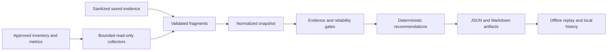

# Architecture

The advisor is a local tool between approved input data and a human review.
It does not sit in the cluster's scaling/control path. An application owner asks
a question; the tool checks configuration and measurements; owners decide what
the resulting investigation or suggestion means for their application.

For example, the input can show CPU usage below a request. The report preserves
the dates, units and supporting facts, but a setting is not proposed unless the
selected check's separate requirements permit it. Missing information is
reported, not filled in. Any approved change happens through customer tooling
and identities outside this runtime.

This page explains technical components and boundaries. New readers should
start with [the first lab](accelerator-docs/getting-started.md) or
[the evidence concept](learning/04-evidence-quality-and-historical-identity.md).
Repeating a saved analysis without new collection is called offline replay;
it describes a past assessment, not today's cluster state.

## Design principles

1. **Snapshot first.** Collect once into a versioned contract, then analyze offline.
2. **Deterministic core.** Rule code, not an LLM, decides recommendations.
3. **Evidence travels with the finding.** Reports retain sources and units.
4. **Safety before density.** Reliability guardrails can suppress an efficiency recommendation.
5. **Adapters, not assumptions.** Prometheus-compatible enterprise observability is a first-class source; Azure Monitor is not mandatory.
6. **Cost is a separate reconciliation.** Do not infer dollars from CPU alone.

## Execution boundary

Run the advisor locally to prepare a profile, inspect sources offline, analyze
saved evidence, or perform explicitly approved bounded collection. The runtime
uses schema 1.0 and versioned recommendation packs; see the
[supported contracts](recommendation-packs.md#supported-contracts).
Cost reconciliation and local artifact history are separate offline workflows.
No hosted scheduler, approval service, Git delivery or cross-cluster placement
engine is supplied. Synthetic tests do not certify customer source compatibility;
validate actual identities, permissions and retained evidence in an approved pilot.

## Evidence requirements

Different questions require different evidence. Missing history must not erase a
valid current-inventory observation or become an invented metric value.

| Assessment | Required evidence | What it cannot establish |
|---|---|---|
| Current configuration | Fresh scoped inventory, exact identities and complete source receipts | Historical behavior, packing feasibility or a removable node |
| Historical usage or reliability | Identity-bound series, representative window, correct units, coverage and freshness | Unobserved peaks, restart causes or historical membership inferred from today's Pods |
| Guarded numeric proposal | All pack-specific history and reliability gates plus an exact owner policy | Change approval, SLO compliance or financial savings |

Baseline mode produces investigations, not numeric targets. Guarded mode permits
supported proposals to be evaluated; it never bypasses missing evidence or
default-off owner controls. CPU requests, memory requests, memory limits and HPA
minimum replicas have separate contracts and require separate canaries.

See [source compatibility](source-compatibility.md), [rule gates](metrics-and-scoring.md#rule-gates)
and [data contracts](data-contracts.md) for precise supported shapes. References,
digests and owner declarations do not authenticate a source or prove approval.

## Components

### Assessment execution

The CLI loads your approved profile and plan, validates their scope, and selects
versioned recommendation packs. Collection, preview and query export use the
same packaged query definitions. Findings retain the selected versions and
configuration locks so they can be replayed. See the
[supported contracts](recommendation-packs.md#supported-contracts).

### Operator surface

Use `catalog` to inspect evidence requirements, `configure` to prepare a profile,
and `preview` to review scope, expressions and budgets without constructing live
clients or acquiring credentials. Optional Grafana exports are query-only assets,
not an assessment backend. The Headlamp preview displays synthetic findings;
it is not a production approval service.

### Inventory collector

The adapter uses Azure Resource Graph for projected, scoped enumeration and preserves inventory metadata with explicit completeness receipts. ARG index freshness and RBAC visibility are not independently proven. Missing required properties leave collection incomplete; the adapter does not fall back to the AKS management API.

### Kubernetes metadata collector

The adapter uses an approved caller-supplied read-only client and verified cluster fingerprint. The CLI requires validated sanitized exports, including for private clusters; network/authentication onboarding still needs pilot validation. No kubeconfig plugins execute. The SDK can receive excluded pod fields transiently because Kubernetes lacks spec-field projection; they are discarded before leaving the reader. A stricter policy requires an approved sanitized reader/export. See [security and privacy](security-and-privacy.md).

### Metric collector

Supports Azure Monitor managed service for Prometheus and generic Prometheus-compatible query endpoints. Queries must be declared in a catalog, aligned to the same range and step, and include coverage. Percentiles must be calculated from samples or recording rules—not averaged from pre-aggregated percentiles.

Metric queries retain exact historical identities and independent quality for
each required series. Current names cannot reconstruct missing UID history.
Packaged recordings are upstream contracts, not assumed built-in AKS telemetry;
the advisor does not install or backfill them. Validate your actual mappings
using the [source profiles](source-profiles.md).

### Cost import

The cost workflow imports one sanitized, explicitly amortized Cost Management
projection with optional operator-reviewed AKS/OpenCost/Kubecost allocation
shares. Exact historical resource bindings and current exact target identities
are required; unmatched rows and residual attribution remain visible. Decimal
currency ledgers separate charge categories from attribution without adding them.
Incomplete, stale, misaligned, unsupported or mixed-currency input blocks
reconciliation. This is an offline artifact/CLI boundary, not a native API client
or a service. Savings remain null even when attribution reconciles.
See the [cost contract and source acceptance limits](cost-reconciliation.md).

### Analysis engine

Validates freshness, computes ratios and rollups, evaluates rules, applies guardrails, and assigns confidence. The engine must remain independently executable from the CLI.

### Local assessment history

Import verifies original artifact hashes, tenant/input/configuration bindings
and locked replay before publishing a local immutable run. Compare only runs
with compatible scope, pack definitions, configuration and windows. A missing
finding never proves resolution or savings. Tenant binding is not authentication;
you provide filesystem access, encryption, retention and a single writer.
See [local history operations](operations/history.md).

## Running the solution

| Mode | Operational boundary |
|---|---|
| Offline CLI | Inspect packs, configure profiles, preview operations, analyze saved evidence, reconcile cost or compare local history; no source access. |
| Approved collection | Invoke `collect` or `assess` with an approved plan and `--allow-live`; read only the explicit source scope within configured budgets. The CLI uses sanitized Kubernetes exports. |
| Headlamp preview | Inspect synthetic findings; not a live importer, production authorization service or delivery backend. |

No AI model is required or called by the advisor. Customer-approved changes
are implemented through separate customer tooling and identities, not this runtime.

## Identity and permission boundaries

- Azure inventory: `Reader` scoped to approved subscriptions or management group.
- Cost: the offline import requests no billing identity or API permission. Preparing an approved billing export is a separate operator activity.
- Kubernetes: a custom ClusterRole with `get/list` for selected metadata resources; the implemented reader starts no watches and needs no secrets, exec, attach, port-forward, create, patch, update, or delete.
- Artifacts: customer-controlled local access, encryption, audience and retention; no cloud storage service is provisioned.

## Failure modes

- **Partial subscription enumeration:** fail the completeness check and mark the report partial.
- **Low metric coverage:** suppress actionable metric-based findings and retain blocked reasons; lower confidence cannot bypass a reduction gate.
- **Identity mismatch:** retain unmatched cost and omit savings.
- **Burst-sensitive workload:** reliability guardrail overrides density guidance.
- **Conflicting autoscalers:** emit a configuration-risk finding; do not recommend both on the same metric.
- **Stale snapshot:** block affected recommendations; never use a historic replay clock to make current evidence appear fresh.
