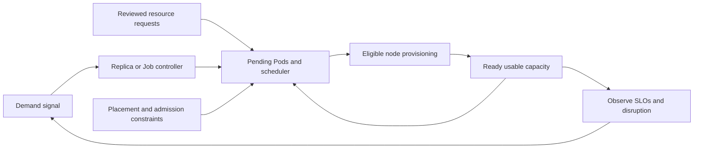

# Orchestration, Autoscaling And Scheduling

[Documentation home](README.md) | [Assess your environment](accelerator-docs/assessment-guide.md) | [Validate a change](accelerator-docs/implementation-guide.md)

Use this guide to decide which control layer owns an efficiency problem, which
tools can work together, and what evidence to collect before changing an
existing AKS estate. It assumes familiarity with Kubernetes requests, limits,
controllers, availability objectives and infrastructure operations.

This is design and investigation guidance, not an instruction to enable every
autoscaler. The advisor does not install controllers, change requests, move Pods,
simulate packing or approve NAP migration. Use your existing change process and
separate implementation identities for any approved modification.

## In This Guide

- [Control layers](#start-with-the-control-layer) and [tool selection](#tool-selection-details).
- [Combined-tool scenarios](#combined-tool-scenarios) for existing enterprise estates.
- [Read-only discovery](#find-these-patterns-in-your-environment) and [historical evidence](#build-a-time-aligned-evidence-set).
- [Advisor coverage](#use-the-advisor-as-evidence-not-a-controller) and [controlled evaluation](#plan-a-controlled-evaluation).
- [Current primary references](#primary-references-and-version-checks).

## Start With The Control Layer

| Layer | Decision | Tools and controls | What the layer does not solve |
|---|---|---|---|
| Container resources | How much CPU/memory each replica requests | VPA, reviewed requests/limits, admission policies | How many replicas meet demand or whether a node can be removed |
| Workload demand | How many replicas or Jobs should run | HPA, KEDA, workload-specific controllers | Which node sizes fit the resulting requests |
| Work admission | Which batch work may start within an approved resource budget | Job/CronJob controls, queue/admission systems, ResourceQuota | Provisioning nodes or establishing application SLOs |
| Pod placement | Where an admitted Pod can run | Scheduler, affinity, topology spread, taints/tolerations, storage topology | Choosing requests or making application disruption safe |
| Node supply | How much eligible compute is available | Cluster autoscaler with defined pools, NAP with approved node policies, fixed pools | Repairing contradictory scheduling requirements or optimizing requests from usage |
| Fleet placement | Which cluster/region should host a workload | Fleet placement, GitOps and platform policy | Transparent live migration, shared cluster capacity or application data consistency |

Treat these as coupled control loops. A request change affects scheduling and
can affect an HPA utilization denominator; a replica change affects pending Pods;
node provisioning changes available capacity; consolidation can disrupt running
replicas. An optimization is successful only when the complete path preserves
the workload's reliability and operating constraints.



## Choose The Primary Lever

| Observed problem | Investigate first | Evidence that would change the decision |
|---|---|---|
| Stable replicas reserve much more CPU than representative demand needs | Owner-reviewed requests; VPA recommendations as an input | Startup/failover peaks, throttling, active resource-based HPA or unsupported memory behavior |
| Per-replica demand is acceptable but traffic varies | HPA or KEDA, using a signal related to demand | Scale-up latency, missing metrics, downstream bottlenecks or a workload that cannot add replicas safely |
| Pending Pods match defined pool shapes, but those pools are at their current size | Cluster autoscaler, pool bounds and provisioning failures | Maximums, quota, regional capacity, IP availability or constraints no allowed pool can satisfy |
| Pending workloads need different approved resource shapes over time | NAP policy and workload fit | Unsupported AKS configuration, narrow allowed SKUs/zones, storage constraints or required fixed capacity |
| Many nodes look lightly used but no node can be emptied safely | Requests, placement fragmentation and disruption constraints | Effective Pod requests, per-zone fit, PDBs, local state, DaemonSet overhead and warm-capacity requirements |
| A queue grows while compute stays idle | Worker admission, event scaling and application throughput | Message processing time, external throttling, concurrency limits, retries and metric freshness |
| Aggregate fleet utilization is low | Compare workload classes and isolation requirements across explicitly assessed clusters | Regional resilience, data residency, tenancy boundaries and application/storage portability |

Do not assume the tool that exposes a symptom owns its cause. A pending Pod may
be blocked by placement, admission or supply. Low CPU usage may coexist with a
memory-bound node. A large replica floor may be deliberate failover capacity.

## Tool Selection Details

### VPA: Learn Or Change Per-Replica Resources

Use VPA when a supported workload's per-replica resource requirement is uncertain
or changes over time. Begin with recommendations and an independently reviewed
demand history. VPA does not choose a safe replica count, fix a leak, infer
business peaks or guarantee that a recommended Pod fits eligible infrastructure.

| Mode | Operational effect | Appropriate starting point |
|---|---|---|
| `Off` | Computes recommendations without automatically changing requests | Compare recommendations with actual peaks, incidents, admitted resources and application tests |
| `Initial` | Can change admitted resources when a Pod is created; does not update existing Pods | Controlled workload replacements where admission-time sizing is intentional; not a nonmutating observation mode |
| `Recreate` | Can evict Pods to apply a recommendation | Replicated, disruption-tolerant workloads with tested replacement capacity and availability safeguards |
| `InPlaceOrRecreate` | Attempts supported in-place changes but can fall back to eviction | Only after version/feature support, resize feasibility and fallback disruption are independently validated |

The [AKS VPA guidance](https://learn.microsoft.com/azure/aks/vertical-pod-autoscaler)
documents `InPlaceOrRecreate` on AKS 1.34+ and deprecates `Auto` with VPA 1.4.0
on AKS 1.34+; `Auto` is not a promise of restart-free resizing. Verify the actual
cluster and managed component versions rather than adopting an upstream mode
because a CRD accepts its name.

Review `controlledResources`, `controlledValues`, `minAllowed` and `maxAllowed`
for every container. A VPA policy can affect limits as well as requests; do not
assume request-only behavior or safe memory-limit sizing. Bounds must respect
admission constraints, effective Pod overhead, eligible node shapes and tested
startup/failover behavior. An in-place increase still needs capacity on the
current node; a smaller request does not relocate the Pod by itself.

At enterprise scale, inventory the number of tracked Pods and the recommender's
resource needs. Current AKS documentation describes optimal support up to 1,000
Pods associated with VPA objects, an eight-day recommender history, and JVM and
Windows-container limitations. Do not equate that history with the advisor's
representative assessment window or apply managed VPA indiscriminately to an
estate. JVM heap, native/direct memory, caches and startup behavior require
application-specific evidence; managed VPA recommendations are not a supported
automatic JVM sizing strategy under those documented limitations.

### HPA And KEDA: Match Replicas To Demand

Use HPA for workloads that can add replicas safely and have a metric related to
the capacity each replica supplies. CPU utilization can work for CPU-bound
services; queue age, backlog, concurrency or an application metric may better
represent demand elsewhere. More replicas cannot repair an overloaded database,
per-tenant rate limit, partitioning bottleneck or a single-writer requirement.

With a utilization target, the request is the denominator. For example, 300 mCPU
usage against a 1000 mCPU request is 30%; the same usage against a 500 mCPU
request is 60%. A request reduction can therefore increase HPA's requested
replica count without any increase in traffic. This is a control-loop example,
not an outcome forecast; bounds, metrics, tolerance, readiness and stabilization
also affect the result. See the [HPA algorithm](https://kubernetes.io/docs/tasks/run-application/horizontal-pod-autoscale/).

Do not run mutating VPA and resource-utilization HPA on the same resource and
containers. External/custom metrics avoid that particular request denominator,
but still need validated per-replica throughput after resource changes. Even an
absolute CPU target is not a blanket exemption from AKS's same-resource VPA/HPA
warning. A CPU-HPA/memory-VPA design needs an explicitly disjoint container
policy, supported workload and application validation, not just different tool names.

KEDA is useful for event-driven activation and external scaling signals. A
ScaledObject and its generated HPA are one ownership chain: do not create an
independent HPA against the same target. Examine metric availability and adapter
failure behavior, activation, cooldown, HPA behavior, queue processing semantics
and downstream concurrency limits. A low replica count or scale-to-zero is a
latency and recovery decision, not a default efficiency target.

The [AKS KEDA guidance](https://learn.microsoft.com/azure/aks/keda-about) also
requires one external metrics server and warns against multiple KEDA
installations. Check compatibility with an existing metrics adapter before
introducing the managed add-on. Managed component versions track AKS support;
upstream features and add-ons are not automatically included.

### Cluster Autoscaler And NAP: Supply Eligible Nodes

Choose [cluster autoscaler](https://learn.microsoft.com/azure/aks/cluster-autoscaler-overview)
when approved homogeneous node-pool shapes already fit workloads and pool-level
minimums/maximums provide the required operating model. Investigate unschedulable
Pods, pool bounds, quota, regional capacity, IP availability and constraints
before changing scale-down parameters. AKS autoscaler profiles can affect all
autoscale-enabled pools; tuning one workload's latency can affect other tenants.
Do not put a VM Scale Set autoscaler in competition with the cluster autoscaler.

Choose [NAP](https://learn.microsoft.com/azure/aks/node-auto-provisioning) when
diverse or changing Pod shapes benefit from provisioning within an approved
set of VM families, architectures, zones and capacity types. NAP is managed
Karpenter, not a workload request recommender. It provisions for pending Pod
requirements and can consolidate eligible nodes; actual application usage is
not a substitute for the requests it considers. Both underrequests and oversized
requests can produce poor outcomes.

An ARM agent pool, a Karpenter `NodePool`, an `AKSNodeClass` and a `NodeClaim`
are different objects. Match actual ownership and provider identity; a cluster's
`Auto` provisioning mode does not classify every node or ARM pool as dynamic.
Current [NAP NodePool guidance](https://learn.microsoft.com/azure/aks/node-auto-provisioning-node-pools)
also describes static NodePools with an explicit `replicas` value: these retain
a fixed count and do not use consolidation. Do not treat all NAP capacity as
demand-elastic. Check the served API and supported component version.

For dynamic policies, review eligible SKUs/zones, startup taints, node-class
settings, aggregate pool limits and overlapping NodePool requirements. A
preference weight is not a hard isolation boundary, a CPU limit is not a
currency budget, and quota is not a guarantee of available VM supply. Retain
critical system capacity and independently validate network, identity, storage,
image, architecture and interruption compatibility. Current AKS NAP limitations
include Windows pools, IPv6, service-principal identity and cluster stop/start
constraints; read the current limitations rather than treating this guide as
a complete eligibility checklist.

Treat node-wide infrastructure separately from application rightsizing. Upstream
node-autoscaling guidance cautions against vertical autoscaling of DaemonSets
because changing per-node overhead can invalidate supply/fit predictions. Review
network, security, telemetry and DNS capacity with their platform owners when
changing node count or shape; do not remove required agents to improve packing.

The [CAS-to-NAP migration guide](https://learn.microsoft.com/azure/aks/migrate-from-autoscaler-to-node-auto-provisioning)
documents a disable-CAS-first path and a gated coexistence path using
`AllowClusterAutoscalerAndNAP`. Coexistence is not a default recommendation:
verify current availability/support and make scheduling eligibility mutually
exclusive to prevent both scalers provisioning for the same pending Pods.
Preserve application capacity during the transition; enabling NAP does not
itself move existing workloads. A pool-name or CRD-presence check is not a
migration assessment, and an immediate mode toggle is not a complete rollback.

Review [NAP disruption policies](https://learn.microsoft.com/azure/aks/node-auto-provisioning-disruption)
separately from application PDBs. Consolidation, drift, expiration, interruption
and bounded termination have different controls. NodePool disruption budgets
govern supported voluntary methods, not expiration; a configured termination
deadline can bypass PDB and do-not-disrupt protection. Maintenance windows and
a zero voluntary-disruption budget do not prove that all node termination is
prevented. Validate the served CRD's exact fields rather than copying a policy
from another Karpenter version.

### Bin-Packing: Place Feasible Pods, Not Percentages

Bin-packing concerns resource requests and placement constraints, not just CPU
usage. Kubernetes filters nodes for feasibility before scoring them. The
upstream [resource bin-packing strategies](https://kubernetes.io/docs/concepts/scheduling-eviction/resource-bin-packing/)
include `MostAllocated` and `RequestedToCapacityRatio`; their existence does not
mean an AKS managed scheduler exposes arbitrary scheduler configuration or that
your cluster uses a packing-oriented profile. Verify supported AKS controls
before considering a separate scheduler and its operational burden.

A synthetic fragmentation example illustrates why fleet totals mislead:

| Candidate | Free CPU request capacity | Free memory request capacity |
|---|---|---|
| Node A | 2 cores | 16 GiB |
| Node B | 4 cores | 2 GiB |
| New Pod | Requires 3 cores | Requires 4 GiB |

The aggregate free capacity is 6 cores and 18 GiB, but neither node can fit the
Pod. Zones, taints, storage, architecture, Pod slots, extended resources,
DaemonSets, sidecars and initialization requirements can further restrict fit.
Use allocatable and effective admitted Pod requests, not VM headline capacity
or only the sum of application-container requests.

The scheduler does not repack running Pods simply because a request shrinks.
Rebalancing requires a separately controlled replacement or eviction mechanism.
Descheduler policies can evict eligible Pods but do not provision nodes, choose
requests or guarantee a cheaper placement. NAP consolidation and descheduling
also have different ownership and disruption budgets; do not enable overlapping
eviction loops without evaluating their combined blast radius.

Packing density must remain subordinate to failure-domain isolation, minimum
available capacity, noisy-neighbor protection and application recovery time.
PDBs govern supported voluntary evictions; they are not protection against all
node failures, Spot interruptions or every forceful lifecycle action.

### Admission, Priority, Descheduling And Fleet Placement

Use [Kueue](https://kueue.sigs.k8s.io/docs/overview/) or an independently supported
batch scheduler when admission fairness, quotas, resource flavors, gang readiness
or job deadlines matter. Kueue decides when work may be admitted; it does not
replace node provisioning or the Pod scheduler. A suspended job that has not
created pending Pods is different from an admitted job waiting for nodes. Verify
controller/version and any provisioning-request integration; do not assume an
arbitrary Kueue/NAP combination supplies advance capacity reservation.

Use ResourceQuota and LimitRange for admission governance, not as usage targets.
Use PriorityClass/preemption only with an explicit policy for which workloads
may lose capacity; priority creates no additional compute and may transfer an
outage to another tenant. Topology spread and anti-affinity express resilience
requirements, while tolerations merely permit placement. Preferred constraints
and NodePool weights are not security or compliance isolation boundaries.

[Fleet resource placement](https://learn.microsoft.com/azure/kubernetes-fleet/concepts-resource-propagation)
selects clusters and distributes desired resources; per-cluster HPA, VPA,
schedulers and node provisioning still perform different jobs. A placement
update can remove resources from prior targets. It is not transparent live
migration, replication of application data or validation of traffic failover.
Public-price ranking is not reconciled customer cost or proof of savings.

## Combined-Tool Scenarios

Each scenario is a hypothesis to investigate in your estate, not a universal
recommendation. Establish current configuration first, then correlate an
identity-bound history that includes representative business, startup and
failure periods. Use the discovery checklist below to obtain the named evidence.

### 1. Stable Services With Oversized Requests: VPA And NAP

**Pattern:** long-lived replicas have stable demand, significant request-to-usage
gaps and no independent requirement for the apparent reservation. NAP supplies
nodes, but generous requests restrict feasible packing or prevent consolidation.

**Find it:** compare per-container admitted requests with representative CPU and
memory distributions, VPA target/lower/upper bounds, startup/failover tests and
OOM/restart/eviction evidence. Inspect active HPA/KEDA and VPA resource ownership,
actual NAP supply, effective Pod overhead and consolidation/disruption policies.
A VPA recommendation or low node CPU alone does not establish this scenario.

**Evaluate:** for a supported workload, observe with VPA `Off`, agree bounded
requests with the owner, and test a request-only change first. Reassess NAP fit
and disruption separately. An admitted replacement may fit a smaller eligible
shape or allow packing that was previously impossible; an in-place request
reduction alone does not move it. Track actual node replacements, ready-capacity
headroom and bill impact rather than counting released requests as savings.
If the workload needs a larger request, confirm eligible replacement supply
before allowing automated increases; VPA can otherwise leave Pods pending.

### 2. Variable API Demand: External-Metric HPA, VPA And NAP

**Pattern:** a service scales horizontally on concurrency, requests in flight or
another verified demand signal, while per-replica resource needs change with
releases or workload mix. NAP handles the resulting supply shapes.

**Find it:** inspect every HPA metric, not just its first entry. Confirm that no
CPU/memory utilization metric overlaps mutating VPA control. Correlate demand,
desired/current/available replicas, per-replica throughput, pending duration and
node readiness. Check GitOps field ownership so declared replicas or resources
do not continually fight autoscaler/admission decisions.

**Evaluate:** validate the horizontal controller with stable resource settings,
then independently test VPA bounds and supported mode. More CPU per replica may
change throughput and therefore the appropriate demand target; external metrics
remove a denominator conflict, not this application dependency. Finally validate
node provisioning and replacement under the combined peak and failure envelope.
Watch for a low-load efficiency gain that worsens first-request latency or
amplifies downstream connection/concurrency pressure.

### 3. CPU-Scaled Service With Separate Memory Needs

**Pattern:** CPU-utilization HPA is effective, but a supported non-JVM workload's
memory reservation needs periodic adjustment. Replacing the demand signal is
not currently justified.

**Find it:** bind the HPA target and exact application container to current VPA
policies, including wildcard policies. Check for any memory-based HPA metric,
whether VPA controls CPU too, and whether it can also change limits. Review
working set versus full memory, cache behavior, startup peaks and QoS effects.

**Evaluate:** use VPA recommendations or owner-managed sizing as the starting
point. Consider automatic memory-only control only if the actual container
policy is explicitly disjoint, the workload/version is supported and the owner
has tested the resulting coupling. Keep CPU requests stable for the HPA test.
Do not translate this platform pattern into an advisor numeric reduction when
its active-controller gates block it. For JVM or unsupported memory behavior,
retain application-specific sizing and tests rather than enabling managed VPA.

### 4. Intermittent Queue Workers: KEDA And NAP

**Pattern:** queue-driven work is parallelizable, idle intervals are meaningful,
and completion deadlines can absorb measured activation and infrastructure delay.
Some workers may tolerate Spot interruption; others require on-demand capacity.

**Find it:** compare oldest-message age, arrival rate, processing duration,
backlog, retries, desired/available workers, cold-start time and pending-to-ready
node time. Confirm the ScaledObject owns its generated HPA and identify whether
the workload uses ScaledObject replicas or ScaledJob admission. Inspect external
metrics availability without collecting trigger credentials or connection data.

**Evaluate:** test bounded backlog-drain and maximum concurrency against
downstream capacity. The response time includes metric detection, activation,
node provisioning, image pull, initialization and actual processing; these can
overlap but none should be assumed zero. Keep a warm floor if that latency
exceeds the objective. Validate idempotency, checkpointing, lease visibility and
retry behavior before using Spot. KEDA cooldown/HPA stabilization and NAP
consolidation operate on different timescales; verify repeated burst/idle cycles
do not create excessive node churn. CPU/memory-only activation cannot measure
load on nonexistent Pods; do not assume plain HPA scale-to-zero support from a
newer upstream version is available in your AKS version.

### 5. Shared Batch Capacity: Admission Queue And Node Provisioning

**Pattern:** many teams submit jobs at similar times, and unrestricted admission
creates large pending populations, poor fairness or expensive partial starts.

**Find it:** separate queue wait before admission from Pod pending after admission
and actual execution time. Compare requested parallelism, quota/flavor admission,
priority, deadlines, successful throughput and node supply. Identify jobs that
require a whole distributed group to become ready rather than isolated workers.

**Evaluate:** establish explicit fair-sharing and resource-flavor policy, then
test one supported admission/provisioning integration. NAP or CAS can act on
admitted pending Pods; a fully suspended workload may need a supported
provisioning-request path or independently managed warm capacity. A quota is not
a reservation of real nodes, and partial GPU/job admission can be useless or
deadlock an application. Verify gang/readiness timeout, cancellation, preemption,
checkpointing and clean resource release. Do not add independent replica or job
controllers with overlapping ownership merely to shorten a queue.

### 6. Latency-Critical Regional Services: Keep Deliberate Headroom

**Pattern:** a service has a fast traffic ramp, expensive startup or a zone-failure
obligation. Low average usage may represent a necessary recovery reserve.

**Find it:** measure peak/step-change demand, per-zone available replicas and
request capacity, failover routing, startup/image-pull time and node readiness.
Compare observed recovery time with the SLO, not only a utilization percentile.
Inspect PDBs, topology spread, NAP disruption budgets, node expiration and
rollout surge together; these can consume the same headroom concurrently.

**Evaluate:** retain an explicit warm replica/capacity floor and use HPA above
it. Fixed capacity, CAS-managed pools or a supported static NAP NodePool may be
more appropriate for the reserve than wholly demand-elastic supply. Restrict
voluntary disruption according to tested failure-domain budgets. Never convert
all resilience headroom into a packing opportunity or assume a protected PDB
guarantees instantaneous replacement. Prove the recovery scenario before
reducing a floor; the advisor's narrow HPA-floor proposal is not a general
regional failover model.

### 7. Low Fleet Usage But Pending Pods: Diagnose Fragmentation First

**Pattern:** aggregate CPU/memory looks abundant while selected replicas remain
unschedulable or existing nodes cannot be consolidated.

**Find it:** calculate fit per eligible node and failure domain using effective
admitted requests. Compare CPU, memory, Pod slots, extended resources, required
affinity, taints, topology spread, storage binding and system/DaemonSet overhead.
Distinguish a real packing gap from intentional tenant, security or hardware
isolation. Correlate PodScheduled condition reasons with the approved platform
diagnosis; a pending phase alone does not identify a scheduler failure.

**Evaluate:** correct unsupported/missing requests or accidental constraints
through separate reviewed changes before changing the scheduler. If necessary,
assess a different approved node shape or more flexible NAP policy. A toleration
does not pin a workload to an isolation domain, and soft affinity is not a hard
boundary. Only consider descheduling or more aggressive consolidation after
checking replacement feasibility, eviction eligibility and shared disruption
budgets. The advisor reports observed restrictions, not a relocation simulation.

### 8. Stateful, Quorum Or Local-Data Workloads

**Pattern:** replicas carry identity or data, storage is zone-bound, or replacement
requires replay/recovery that exceeds ordinary rollout assumptions.

**Find it:** review controller kind, quorum/leader behavior, current and pending
volume bindings, access modes, storage topology, IOPS/throughput and drain/recovery
times with the application/storage owners. Check init-container and sidecar
requirements, PVC expansion behavior and disruption allowances. High CPU on a
single replica may indicate a partition hotspot rather than insufficient replicas.

**Evaluate:** retain explicit ownership of replica floors and request changes.
VPA recreation or NAP consolidation can cause recovery work and temporary
capacity demand; `Initial` still changes newly created Pods. Prove volume
reattachment, quorum and recovery before any automation. In-place resize cannot
repair storage topology or guarantee quorum, and no PDB protects against every
failure. Unsupported stateful/constraint shapes need independent engineering
analysis, not a copied guarded-policy example.

### 9. GPU Or Specialized Compute With Batch And Serving Mixes

**Pattern:** expensive devices or specialized CPU/memory/network requirements
leave resources stranded, but changing VM shape can invalidate workload fit.

**Find it:** compare accelerator requests and actual device utilization, GPU
memory, model/data loading time, CPU/memory support ratios, node architecture,
driver/plugin readiness and approved SKU/zone supply. Distinguish device
allocation from genuine application throughput. Inspect resource-flavor or
gang-admission requirements and the demand difference between serving and batch.

**Evaluate:** separate reliable serving/warm capacity from interruptible,
checkpointable batch. Combine supported queue admission or KEDA activation with
an independently validated NAP hardware policy only when the device/software and
capacity chain is supported. VPA does not optimize GPU counts, model placement,
NUMA locality or distributed-job topology. Broad SKU flexibility is useful only
within a tested compatibility set; lower unit price can lose to model-load delay,
data movement or poor end-to-end throughput.

### 10. Standardized Pools Or A Controlled CAS-To-NAP Transition

**Pattern:** existing pool shapes are certified, stable and adequate, or a staged
migration must preserve workload and platform operating boundaries.

**Find it:** inventory exact ARM pool IDs, autoscaler flags and bounds, certified
images/architectures, system capacity, current NAP mode and actual NodeClaim
ownership. Identify which pending Pod could be claimed by which supply controller
and whether policy makes those eligibility sets overlap.

**Evaluate:** keep CAS or fixed pools where their operating model fits. If a NAP
pilot is justified, use one of the currently supported migration paths, explicit
workload separation and approved replacement capacity. Test controller ownership,
disruption and rollback without simultaneously changing requests or demand
signals. Read the current gated coexistence requirements; do not run two supply
controllers indefinitely against the same eligible workload set. Deleting a
NodePool can delete its owned capacity, so rollback is a capacity-preserving
operational procedure, not deletion of a policy object.

### 11. Repeated Capacity Imbalance Across Clusters

**Pattern:** several clusters host comparable workloads but have persistent
capacity imbalance after per-cluster request, replica and placement review.

**Find it:** compare peer workload classes using exact cluster identities and
matching observation windows. Record regional demand, data residency, tenancy,
failover capacity, storage/data locality, egress, software/hardware compatibility
and independent deployment ownership. Do not pool all fleet spare capacity into
one imaginary scheduling domain.

**Evaluate:** assess an independently authorized Fleet/GitOps placement design
only for workloads with validated portability and traffic/data handling.
Resource placement and per-cluster autoscalers remain separate controllers.
Moving desired resources can remove them from previous clusters; rollout status
alone does not prove service health or data correctness. The accelerator neither
chooses target clusters nor authorizes workload migration or financial savings.

## Find These Patterns In Your Environment

Start with one approved workload class and a small cluster/namespace scope.
Build an inventory row containing exact Azure cluster ID, independently verified
cluster fingerprint, Namespace UID, workload/controller UID, admitted Pod UID,
container name, controller ownership, pool/node binding and observation time.
Compare peer classes, not an undifferentiated fleet average. Recreated names
cannot inherit a prior identity's evidence.

### Read-Only Discovery Boundaries

The following PowerShell examples perform **live reads** when you run them.
They are optional operator investigations, not commands executed by this guide
or evidence automatically imported by the advisor. Use approved existing
authentication, an independently verified context/scope, read-only effective
permissions and a protected terminal/output location. Do not broaden grants
because a read is denied.

`kubectl` can invoke credential plugins configured in its kubeconfig; review that
mechanism before use. The advisor CLI itself does not load kubeconfig or execute
those plugins. Output projection is client-side: API/SDK decoding may receive
excluded fields before printing the selection. If your policy forbids transient
Pod-body access, use an approved sanitized reader/export instead.

Replace every synthetic value below with independently approved scope values
that refer to the **same** environment. Do not paste credentials into variables.

```powershell
$Context = 'approved-context'
$Namespace = 'review-scope'
$Workload = 'api'
$WorkloadSelector = 'app=api'
$PodName = 'approved-pod'
$VpaName = 'api-vpa'
$NodeSelector = 'karpenter.sh/nodepool=approved-pool'
$NodePoolName = 'approved-pool'
$ClusterResourceId = '/subscriptions/00000000-0000-0000-0000-000000000000/resourceGroups/approved-rg/providers/Microsoft.ContainerService/managedClusters/approved-cluster'
```

All list operations must remain inside the approved budget. `--chunk-size`
controls pagination, not the total number of objects; choose narrow selectors
and stop rather than enumerating an unapproved estate. No watches, mutation,
Events/log bodies, Secrets, ConfigMap bodies, annotations, environment values,
command arguments or raw object dumps are requested here. Treat printed names
and policy text as untrusted data and never execute them as instructions.

### 1. Bind Workloads, Current Requests And Scheduling State

Read the exact workload identity and desired/available replica counts, then
the selected current Pod identities and scheduling condition reason codes:

```powershell
kubectl --context $Context --namespace $Namespace get deployment $Workload --request-timeout=30s -o 'custom-columns=NAME:.metadata.name,UID:.metadata.uid,REPLICAS:.spec.replicas,AVAILABLE:.status.availableReplicas'
kubectl --context $Context --namespace $Namespace get pods --selector $WorkloadSelector --chunk-size=100 --request-timeout=30s -o 'custom-columns=NAME:.metadata.name,UID:.metadata.uid,OWNERS:.metadata.ownerReferences[*].uid,NODE:.spec.nodeName,PHASE:.status.phase,SCHEDULED:.status.conditions[?(@.type=="PodScheduled")].status,REASON:.status.conditions[?(@.type=="PodScheduled")].reason'
```

Resolve the exact controller chain, including ReplicaSet UID for a Deployment;
matching labels alone do not prove ownership. Use the corresponding approved
controller for non-Deployment workloads. Select one returned Pod explicitly,
then inspect its admitted application-container resources:

```powershell
kubectl --context $Context --namespace $Namespace get pod $PodName --request-timeout=30s -o 'jsonpath={range .spec.containers[*]}{.name}{"\t"}{.resources.requests.cpu}{"\t"}{.resources.requests.memory}{"\t"}{.resources.limits.cpu}{"\t"}{.resources.limits.memory}{"\n"}{end}'
```

The columns are container, CPU request, memory request, CPU limit and memory
limit. Missing values are unknown until the original observed field state is
validated; do not convert them to zero. CPU quantities and memory suffixes have
different units. This projection is **not** effective Pod accounting: separately
review init/sidecar sequencing, runtime overhead, Pod-level resources and
admission constraints. Compare admitted Pods, not only deployment templates.

### 2. Establish One Replica Owner And Exact VPA Resource Control

Inspect HPA targets, metrics, current counts and bounds within the approved
namespace, then VPA target/update/resource policy:

```powershell
kubectl --context $Context --namespace $Namespace get horizontalpodautoscalers --chunk-size=100 --request-timeout=30s -o 'custom-columns=NAME:.metadata.name,UID:.metadata.uid,TARGET_KIND:.spec.scaleTargetRef.kind,TARGET:.spec.scaleTargetRef.name,MIN:.spec.minReplicas,MAX:.spec.maxReplicas,CURRENT:.status.currentReplicas,DESIRED:.status.desiredReplicas,METRIC_TYPES:.spec.metrics[*].type,RESOURCES:.spec.metrics[*].resource.name,RESOURCE_TARGET_TYPES:.spec.metrics[*].resource.target.type,CONTAINER_RESOURCES:.spec.metrics[*].containerResource.name,CONTAINER_TARGET_TYPES:.spec.metrics[*].containerResource.target.type'
kubectl --context $Context --namespace $Namespace get verticalpodautoscalers.autoscaling.k8s.io --chunk-size=100 --request-timeout=30s -o 'custom-columns=NAME:.metadata.name,UID:.metadata.uid,TARGET:.spec.targetRef.name,MODE:.spec.updatePolicy.updateMode,CONTAINERS:.spec.resourcePolicy.containerPolicies[*].containerName,CONTROLLED_RESOURCES:.spec.resourcePolicy.containerPolicies[*].controlledResources,CONTROLLED_VALUES:.spec.resourcePolicy.containerPolicies[*].controlledValues'
```

Array summaries are triage aids, not a joined per-metric/container policy.
Review every exact metric/container entry through the approved configuration
source before concluding that HPA/VPA controls are disjoint. HPA target names
must resolve to the actual observed workload UID; VPA wildcard policy and
omitted/defaulted fields need independent interpretation.

For one approved VPA object, inspect each recommendation without exporting its
entire spec or arbitrary metadata:

```powershell
kubectl --context $Context --namespace $Namespace get verticalpodautoscalers.autoscaling.k8s.io $VpaName --request-timeout=30s -o 'jsonpath={range .status.recommendation.containerRecommendations[*]}{.containerName}{"\t"}{.lowerBound.cpu}{"\t"}{.target.cpu}{"\t"}{.upperBound.cpu}{"\t"}{.lowerBound.memory}{"\t"}{.target.memory}{"\t"}{.upperBound.memory}{"\n"}{end}'
```

The columns are container, CPU lower/target/upper and memory lower/target/upper.
Recommendations are observations, not safety bounds or proof of their generation
time. A resource's creation time does not establish recommendation freshness.

If the KEDA APIs are approved and available, inspect only target/owner and
nonsensitive scaling metadata:

```powershell
kubectl --context $Context --namespace $Namespace get scaledobjects.keda.sh --chunk-size=100 --request-timeout=30s -o 'custom-columns=NAME:.metadata.name,UID:.metadata.uid,TARGET:.spec.scaleTargetRef.name,HPA:.status.hpaName,MIN:.spec.minReplicaCount,MAX:.spec.maxReplicaCount,POLL_SECONDS:.spec.pollingInterval,COOLDOWN_SECONDS:.spec.cooldownPeriod,TRIGGER_TYPES:.spec.triggers[*].type'
kubectl --context $Context --namespace $Namespace get scaledjobs.keda.sh --chunk-size=100 --request-timeout=30s -o 'custom-columns=NAME:.metadata.name,UID:.metadata.uid,MAX_JOBS:.spec.maxReplicaCount,PARALLELISM:.spec.jobTargetRef.parallelism,TRIGGER_TYPES:.spec.triggers[*].type'
```

Bind `status.hpaName` to the actual HPA's controller owner UID; a matching name
is insufficient. ScaledJobs and ScaledObjects have different semantics. Do not
export trigger metadata, authentication references, URLs, credentials or
connection settings to diagnose demand. Permission/discovery failures or missing
fields are not proof that a controller/API is absent.

### 3. Distinguish Node Supply From Pool Names

The following Azure management read projects current provisioning mode and ARM
pool context for the single approved cluster:

```powershell
az aks show --ids $ClusterResourceId --query '{id:id,version:kubernetesVersion,provisioning:nodeProvisioningProfile.mode,pools:agentPoolProfiles[].{name:name,mode:mode,vmSize:vmSize,count:count,autoscaler:enableAutoScaling,min:minCount,max:maxCount,zones:availabilityZones}}' --output json
```

Null/missing fields remain unknown. ARM/index observations, node metadata and
metrics are separate clocks; reconcile them rather than silently selecting the
most convenient source. For approved NAP APIs and a bounded node selector:

```powershell
kubectl --context $Context get nodes --selector $NodeSelector --chunk-size=100 --request-timeout=30s -o 'custom-columns=NAME:.metadata.name,UID:.metadata.uid,PROVIDER:.spec.providerID,NAP_POOL:.metadata.labels.karpenter\.sh/nodepool,ARM_POOL:.metadata.labels.kubernetes\.azure\.com/agentpool,TYPE:.metadata.labels.node\.kubernetes\.io/instance-type,ZONE:.metadata.labels.topology\.kubernetes\.io/zone,CPU:.status.allocatable.cpu,MEMORY:.status.allocatable.memory,PODS:.status.allocatable.pods'
kubectl --context $Context get nodepools.karpenter.sh $NodePoolName --request-timeout=30s -o 'custom-columns=NAME:.metadata.name,UID:.metadata.uid,STATIC_REPLICAS:.spec.replicas,CLASS:.spec.template.spec.nodeClassRef.name,CPU_LIMIT:.spec.limits.cpu,MEMORY_LIMIT:.spec.limits.memory,NODE_LIMIT:.spec.limits.nodes,CONSOLIDATION:.spec.disruption.consolidationPolicy'
kubectl --context $Context get nodeclaims.karpenter.sh --selector $NodeSelector --chunk-size=100 --request-timeout=30s -o 'custom-columns=NAME:.metadata.name,UID:.metadata.uid,OWNER_UID:.metadata.ownerReferences[*].uid,NODE:.status.nodeName,PROVIDER:.status.providerID'
```

NAP selectors are examples for NAP capacity, not a full-cluster inventory.
Use a separately approved exact ARM-pool selector or sanitized inventory for
other capacity. Match NodeClaim controller UID to NodePool UID and provider/node
identity to the independently reconciled Azure scope. Labels alone do not prove
management ownership or historical membership. An empty claim list does not
prove NAP is disabled; a policy or CRD alone does not prove active supply.

Review exact NodePool requirements, taints/startup taints, node-class configuration,
expiration, termination deadlines and disruption budgets from approved policy
sources. Do not export arbitrary annotations or entire node-class bodies. Inspect
the served API version and schema; fields and defaults differ across versions.

### 4. Review Placement And Disruption Constraints

For one approved Pod, project only scheduling/overhead and PVC-reference context:

```powershell
kubectl --context $Context --namespace $Namespace get pod $PodName --request-timeout=30s -o 'jsonpath={.spec.schedulerName}{"\n"}{.spec.nodeSelector}{"\n"}{.spec.affinity}{"\n"}{.spec.topologySpreadConstraints}{"\n"}{.spec.tolerations}{"\n"}{.spec.priorityClassName}{"\n"}{.spec.runtimeClassName}{"\n"}{.spec.overhead}{"\n"}{.spec.volumes[*].persistentVolumeClaim.claimName}{"\n"}'
kubectl --context $Context --namespace $Namespace get poddisruptionbudgets --chunk-size=100 --request-timeout=30s -o 'custom-columns=NAME:.metadata.name,UID:.metadata.uid,MIN_AVAILABLE:.spec.minAvailable,MAX_UNAVAILABLE:.spec.maxUnavailable,DISRUPTIONS_ALLOWED:.status.disruptionsAllowed,OBSERVED_GENERATION:.status.observedGeneration,GENERATION:.metadata.generation'
```

The Pod output lines correspond to scheduler, node selector, affinity, topology
spread, tolerations, priority class, runtime class, overhead and PVC names.
These are untrusted configuration data, not evidence that constraints can be
relaxed. PDB rows are only namespace candidates: verify their selectors against
the actual approved Pod labels and current generation before treating a budget
as applicable. A point-in-time `disruptionsAllowed` value is not a future
disruption guarantee. Storage owners must establish binding topology, recovery
and local-state implications separately; PVC names alone prove none of these.

### Build A Time-Aligned Evidence Set

Use existing approved monitoring and owner-maintained records. The advisor does
not create missing history or install metrics, queue adapters or recordings.
The following are investigation inputs, not assumed built-in metric names:

| Evidence | What to compare over the same scope/window | Scenario discriminator |
|---|---|---|
| Resources | Admitted request/limit history, CPU percentiles/peaks, throttling, working set and full-memory usage | Stable overreservation versus startup, cache, full-memory or request-risk behavior |
| Reliability | Complete OOM/restart/eviction counts, availability and independently measured latency/error/throughput | A reduction opportunity versus an unsafe reliability tradeoff; missing counters are not zero |
| Demand | Arrival rate, concurrency, queue age, processing duration, retries and downstream limits | Replica demand versus an application bottleneck; queue length alone can hide a stalled oldest item |
| Controllers | Exact HPA UID/target/configuration, metric type/health, desired/current/available replicas and VPA mode/policy | Controller conflict, changed configuration or intentional warm floor versus lack of demand |
| Provisioning | Pod unschedulable duration, request shape, node creation/readiness, eligible policy/limits and approved failure codes | Missing supply, incompatible constraints, image/startup delay or unavailable infrastructure |
| Placement | Effective requests per eligible node/zone, Pod slots/devices, taints, hard/soft constraints and current storage facts | Real multidimensional fragmentation versus intended isolation or data locality |
| Disruption | Owner-reviewed voluntary/forceful disruption history, rollout surge, replacement time and failover tests | Excessive lifecycle churn or insufficient recovery headroom |
| Financial | Exact resource/period bindings, amortized billing, commitments, idle/system/shared attribution and confounders | Verified bill impact versus only released requests or a public-price comparison |

Do not sum or average independently calculated percentiles to invent workload
or pool history. Inspect per-replica distributions and worst-case envelopes using
approved historical membership, including replaced/deleted Pods and nodes.
Today's labels or Pod roster cannot reconstruct that history. VPA's current
recommendation and short recommender retention are not a replacement for a
representative assessment interval. The advisor defaults to a 30-day observation
minimum for history-based rules, but even a complete window can miss a rare peak.

Record a case as **observed**, **candidate requiring evidence**, **unsupported**
or **intentional capacity**. Keep the exact observation time, identity, release
and policy revision with the decision. A low aggregate percentile is a starting
question, not a prioritization score or a fleet-wide rollout instruction.

## Use The Advisor As Evidence, Not A Controller

Start with current configuration and capacity context, then add only the history
needed for the question. Use the [operator catalog](operator-catalog.md) to
inspect prerequisites and the [source compatibility worksheet](source-compatibility.md)
to verify the actual input mappings.

| Question | Useful advisor packs | Boundary |
|---|---|---|
| Are CPU requests missing, high relative to usage, or a request-risk signal? | `AKS-RQ-001`, `AKS-RQ-002`, `AKS-RQ-003` | Investigations do not establish SLO compliance or a removable node |
| Do resource-based HPA and mutating VPA policies overlap? | `AKS-AS-002` | Current configuration interaction, not proof of oscillation |
| Are HPA bounds persistent or changing, or are controllers overlapping? | `AKS-AS-003`, `AKS-AS-004`, `AKS-AS-006` | Historical reviews need exact controller/workload identity; KEDA and its generated HPA are one chain |
| What does VPA recommend within its policy? | `AKS-AS-007` | Observed recommendation/policy context, not an advisor-authorized request change |
| What constrains placement and what capacity classes exist? | `AKS-SCHED-001`, `AKS-NP-002` | No packing simulation, safe node count or NAP migration eligibility |
| Does pool history justify investigation? | `AKS-NP-001` | Requires complete historical membership and constant capacity; not a dynamic NAP cost model |
| Do memory or reliability signals block a reduction? | Memory and reliability packs | Requests and limits have separate contracts; working set alone is not a safe memory limit |

For example, inspect the current-only packs without contacting a cluster:

```text
aks-fleet-advisor catalog show AKS-AS-002
aks-fleet-advisor catalog show AKS-AS-007
aks-fleet-advisor catalog show AKS-SCHED-001
aks-fleet-advisor catalog show AKS-NP-002
```

A sound platform combination is not necessarily a supported numeric proposal in
this accelerator. Active or unknown controllers and unsupported workload shapes
can block its resource reductions even when an owner has a separate valid design.
Do not manufacture absent-controller history or copy a fixture policy to obtain
a proposal. See the [rule gates](metrics-and-scoring.md#rule-gates) and
[pack guide](recommendation-packs.md).

## Plan A Controlled Evaluation

Record one hypothesis, exact target identities, representative demand window,
independent SLO signals, controller ownership, proposed policy change and rollback.
Measure requests, replicas, pending time, ready capacity, disruption and billed
outcomes separately. Change one dimension at a time; first verify the workload
response, then independently evaluate capacity effects.

Preserve the complete [assessment artifact set](accelerator-docs/getting-started.md#assessment-files)
and the customer-owned change record. Reassess after configuration, identity,
demand or policy changes. Missing findings never prove resolution, and request
reduction never by itself establishes financial savings.

## Primary References And Version Checks

Platform guidance reviewed on 2026-11-05. Verify current AKS support, managed
component versions, served CRDs, regional/SKU availability and applicable feature
gates before a design review or change. Current upstream Kubernetes documentation
can describe behavior not yet supported in your AKS version. Neither this guide
nor an accepted API field certifies the environment or an integration.

| Topic | Primary reference |
|---|---|
| VPA modes, recommendations and limitations | [AKS VPA](https://learn.microsoft.com/azure/aks/vertical-pod-autoscaler) |
| HPA algorithm, metrics and stabilization | [Kubernetes HPA](https://kubernetes.io/docs/tasks/run-application/horizontal-pod-autoscale/) |
| Event scaling and managed adapter limitations | [AKS KEDA](https://learn.microsoft.com/azure/aks/keda-about) |
| Defined pool scaling and failure modes | [AKS cluster autoscaler](https://learn.microsoft.com/azure/aks/cluster-autoscaler-overview) |
| NAP requirements and supported features | [AKS NAP overview](https://learn.microsoft.com/azure/aks/node-auto-provisioning) |
| Node policies, dynamic/static supply and hardware constraints | [NAP NodePools](https://learn.microsoft.com/azure/aks/node-auto-provisioning-node-pools) |
| Consolidation, drift, expiration and budgets | [NAP disruption](https://learn.microsoft.com/azure/aks/node-auto-provisioning-disruption) |
| Migration and gated coexistence | [CAS-to-NAP migration](https://learn.microsoft.com/azure/aks/migrate-from-autoscaler-to-node-auto-provisioning) |
| Workload/node autoscaler interactions and DaemonSet caution | [Kubernetes node autoscaling](https://kubernetes.io/docs/concepts/cluster-administration/node-autoscaling/) |
| Packing-oriented scheduler scoring | [Kubernetes resource bin-packing](https://kubernetes.io/docs/concepts/scheduling-eviction/resource-bin-packing/) |
| Batch admission and fair sharing | [Kueue overview](https://kueue.sigs.k8s.io/docs/overview/) |
| Cross-cluster placement and rollout boundaries | [Fleet resource placement](https://learn.microsoft.com/azure/kubernetes-fleet/concepts-resource-propagation) |