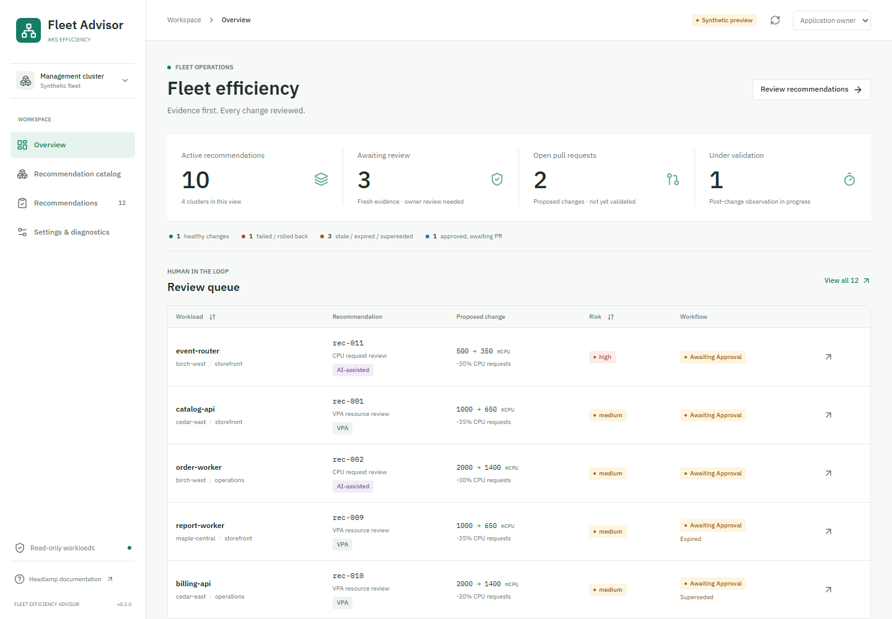

# Headlamp Fleet Efficiency

A Kubernetes-native review workspace for AKS Fleet Efficiency Advisor findings.
The Python engine remains read-only and unchanged. This package implements the
UI, typed management-cluster resources, review contract and backend provider
interface, not a production governance service.



## Scope

- Manifest-generated pack catalog, glossary, bounded parameter guidance
  and synthetic baseline examples, available without recommendation evidence.
- Optional original Python `OperatorInspection`: pack/query/version/digest,
  effective parameters, source-profile capabilities/gaps and resolved queries.
  Missing provenance stays unknown rather than adopting the installed catalog.
- Fleet overview and filterable, sortable, deep-linkable recommendation table.
- Separate measured facts, deterministic policy, VPA bounds, AI interpretation,
  human decisions, PR state and observed validation outcomes.
- Approval, rejection, deferral, observation, exception and cancellation controls.
- Generation/evidence/source-revision binding, expiry, supersession, freshness,
  independent approval roles, optimistic concurrency and idempotency contracts.
- Read-only diagnostics and graceful absence of VPA, metrics or governance.
- Extension renderers for VPA, grounded AI explanations and generic findings.

**Production actions default to disabled.** Only the local preview uses the
in-memory simulator. It makes no GitHub/Kubernetes requests and resets on reload.
It is not a real authorization or audit implementation. AI does not generate
facts/proposals or approve actions. VPA memory targets do not become memory
proposals. No financial savings are calculated in the UI.

Non-goals: Backstage, FinOps Toolkit, OpenCost, Fleet Manager, automatic PRs,
direct workload/VPA/HPA/KEDA/Karpenter mutations and conversational AI.

## Develop

Node 22 LTS and npm are recommended. The SDK's optional i18n tooling warns on
Node 24; local tests/builds also ran on Node 24. No credentials are needed.

```sh
cd plugins/headlamp-fleet-efficiency
npm ci
npm run dev
```

Open http://127.0.0.1:5173/fleet-efficiency. The visible preview-role selector
changes only synthetic identities; it is not included in the Headlamp runtime.

```sh
npm run verify
npx playwright install chromium
npm run test:e2e
npm run package
```

`verify` checks generated contract drift, formatting, unit/component/mock-API
tests, strict TypeScript and both builds. Browser tests cover desktop/mobile,
independent approvals, PR requests, validation and denied/stale states. They use
only synthetic fixtures. Screenshots are refreshed by the overview browser test.
The independent Python gate remains `make verify` or `python scripts/verify.py`.

Run `npm run generate:contracts` after changing the envelope or Python finding
or operator schemas. First run the Python `scripts/generate_operator_catalog.py`
and `scripts/generate_schemas.py` generators from the repository root.
It regenerates TypeScript finding/operator types, review/VPA runtime schemas and
the structural CRD; `npm run check:contracts` never repairs drift. Generated
artifacts are not hand-edited. Run `npm run generate:samples` when fixture content
changes; `check:samples` verifies the fixed-clock manifests. This package is
independent, not a new root monorepo.

The standalone preview alone supports `?scenario=empty`, `denied`, `baseline`,
`guarded`, `unsupported`, `limit` and `floor` for synthetic browser acceptance.
Guarded/unsupported source gaps remain visible and block resource approval;
separate memory-limit and HPA-floor approval paths remain unsupported. The
catalog shows templates as non-executable; use the Python CLI's
[source-bound export workflow](../../docs/recommendation-packs.md#operator-workflow)
for executable PromQL and optional query-only Grafana assets.

## Install

SDK 0.14.0 / React 18.3.1 targets Headlamp 0.40+; pin and acceptance-test your
host. AKS Desktop currently references SDK ^0.13.1 on its main branch; compatibility
is **not certified** against a packaged desktop release. Official KEDA/Karpenter,
Flux/Argo CD, Prometheus, AI Assistant and OpenCost patterns were reviewed; their
code was not copied and none is a runtime dependency.

1. Build with `npm run build`; the plugin output is `dist/main.js` plus metadata.
2. Install the plugin directory through your Headlamp deployment's supported
   plugin-directory mount or plugin manager. Desktop manual plugin directories
   follow https://headlamp.dev/docs/latest/development/plugins/building/.
3. Configure the management cluster and namespace; this plugin never switches to
   source clusters based on recommendation display names/resource IDs.
4. Have an operator review/install the generated CRD and narrowly scoped RBAC
   under `../../deploy/headlamp/`. No automatic cluster setup runs.
5. Supply records through an approved publisher/controller. Applying sample YAML
   alone does not populate status: the CRD has a status subresource.
6. Deploy an authenticated governance backend before enabling actions.

The standalone `preview-dist` is a synthetic development artifact, **not** the
production plugin or backend. Do not expose it as an authenticated review service.

## Configuration And Security

The default namespace is `fleet-efficiency-system`. An integrator can call the
exported `configureFleetAdvisor({ namespace, governanceRequest })` before the
route mounts, or supply that configuration in an operator-reviewed build of the
entrypoint. `governanceRequest` is an injected same-origin authenticated JSON
transport, not a URL/token field. It must protect against CSRF, enforce timeouts,
sanitize errors and never forward source-cluster credentials. No browser token
storage or arbitrary backend URL setting is provided.

Optional `relatedLinks.keda` and `relatedLinks.karpenter` callbacks may be supplied
by a host integration that has verified those plugins and their installed routes.
They receive typed related-resource references; without a callback, links are omitted.

Each decision is re-authorized server-side. The frontend capability response is
only a control hint. Reviewers receive no write grants to workloads or review
status; custom approval verbs are checked by the backend with SubjectAccessReview.
No source metadata, logs, Secrets or ConfigMap bodies are collected by this UI.
Untrusted AI/labels/comments render as React text, never raw HTML.

See [architecture and backend contract](docs/architecture.md),
[permissions and threat model](docs/security.md), and
[configuration and operator runbook](docs/operations.md).

## Acceptance Limits

Automated integration uses a mock Kubernetes JSON API and mock GitHub. No actual
Headlamp deployment, local Kubernetes API or GitHub App was exercised. A production
backend, immutable audit store, publisher, repository templates, admission policy,
host-version compatibility and live deployment acceptance remain release gates.