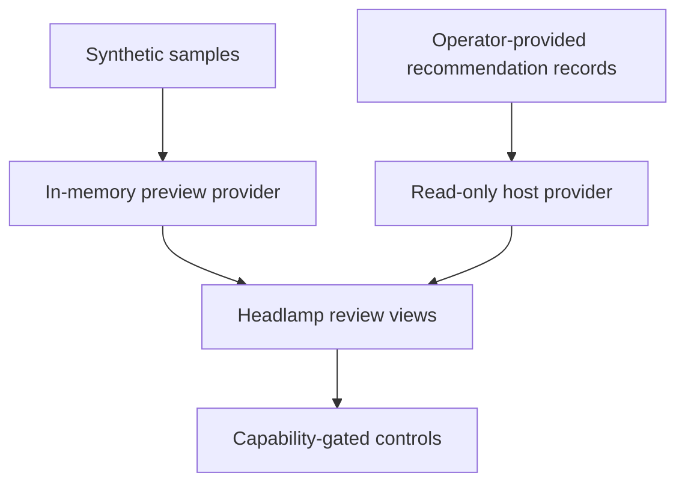

# Headlamp Runtime Boundaries

The plugin displays deterministic advisor findings; it does not run the analysis
engine or change source workloads. Use the [plugin guide](../README.md) for
the standalone preview and host setup. The preview uses synthetic records and
in-memory decisions, not real authentication or durable approvals.

## Data Flow

The advisor supplies no engine-to-cluster publisher or authenticated governance
backend. Do not treat the host templates or preview as an operational service.
Production controls remain disabled without an independently supplied and
approved backend.

`spec.finding` reuses the schema-1.0 advisor recommendation verbatim; generated
TypeScript is not a competing rule model. Exact cluster resource ID and workload
UID are retained. The wrapper adds immutable policy/provenance and observed
workflow. `status` is backend-owned, never directly patched by the browser. The
plugin reads one management namespace with bounded pages (20 x 250, at most 5000
objects). List errors, repeated cursors, scope conflicts and inconsistent resource
versions fail closed instead of displaying partial data as a complete fleet.

Source VPA bounds are embedded with collection time. Optional current-context VPA
objects are separately labelled: matching names do not prove source-cluster
identity. Missing or mutating VPA state never authorizes request changes.

## Provider And Approval Boundary

The host integration supplies transport and authentication. There is no
unauthenticated default fetch adapter or static credential configuration.
Resource-scoped capabilities control which actions can be offered; unknown or
failed permissions deny actions. Names, namespace and UID disambiguate records.
The browser does not establish backend authority or a durable audit record.

Baseline numeric proposals, unknown/unsupported capabilities, stale evidence
and conflicting identities cannot authorize a request change. Memory-limit and
replica-floor records are refused by the resource-request workflow, including
mixed imported proposals. Owner review, authorization, implementation and
outcome validation remain separate customer responsibilities.

## Extension Points

`RecommendationRenderer` supports typed summaries, evidence and related resources.
VPA, AI-explanation and generic renderers are provided. KEDA/Karpenter route links
must be supplied by a host integration that confirms installed plugin/version
support; by default related links are omitted. No KEDA/Karpenter write API exists.
The embedded findings support optional metrics; no metric query/inference is
performed, and charts remain unavailable without an actual verified metrics feed.

No UI state proves a production deployment occurred, a finding was resolved or
money was saved. The simulator tests client behavior only and cannot certify
customer identity, source evidence or an external backend.